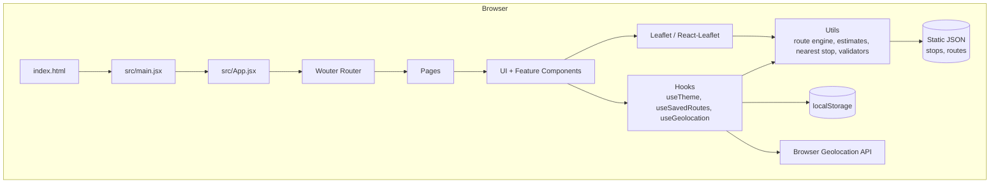
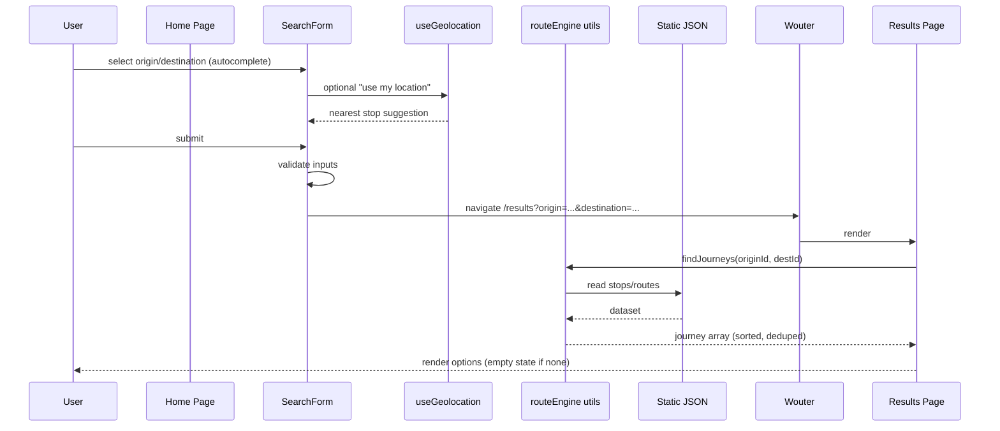

# Architecture — Para

## 1. Overview

Para is a **React single-page application (SPA)** built with Vite. It has **no backend and no server rendering**. All domain logic runs in the browser; all route/stop data is bundled as static JSON. Hosting is on Vercel as static assets.

The architecture prioritizes:

- clarity of module boundaries,
- testability of pure domain logic,
- mobile-first UI,
- honest static-data behavior,
- minimal dependencies.

## 2. Application entry point

- `index.html` mounts `#root`.
- `src/main.jsx` creates the React root and renders `<App />` inside `StrictMode`.
- `src/App.jsx` composes:
  - Theme provider/context
  - Router (Wouter) with route definitions
  - Global layout (header, navigation)
  - Top-level error boundary (recommended)

No server entry, no hydration, no SSR.

## 3. Routing (Wouter)

Planned routes:

| Path         | Page         | Purpose                                                                                                    |
| ------------ | ------------ | ---------------------------------------------------------------------------------------------------------- |
| `/`          | Home         | Search form                                                                                                |
| `/results`   | Results      | Journey options list, with recoverable origin/destination stop IDs in `?from=` and `?to=` query parameters |
| `/route/:id` | RouteDetails | Single journey detail                                                                                      |
| `/map`       | Map          | Interactive map (lazy loaded)                                                                              |
| `/saved`     | SavedRoutes  | Saved journeys                                                                                             |
| `*`          | NotFound     | 404                                                                                                        |

Wouter is chosen for its tiny size and simple API. Route parameters drive detail views; search criteria may be passed via query string to keep results shareable and refresh-safe.

## 4. Page and component relationships

- **Pages** (`src/pages/`) compose feature components and hooks; no heavy logic.
- **Feature components** (`src/components/search`, `routes`, `map`, `common`) implement UI for a feature area.
- **UI primitives** (`src/components/ui/`) implement reusable, styled, accessible elements.
- **Layout** (`src/components/layout/`) implements Header, MobileBottomNav, Container, PageShell.

Data flows down via props; events bubble up via callbacks. Shared state that is truly global (theme) uses context. Route search results are passed via navigation state/query, not a global store.

## 5. Custom route-finding engine

Implemented in `src/utils/` as pure functions:

- `buildGraph.js` (or within `routeEngine.js`): constructs adjacency between stops/routes.
- `findRoutes.js`: direct and one-transfer discovery.
- `rankRoutes.js`: sorting/deduplication.
- `estimate.js`: duration and fare estimation.

Engine inputs: origin stop id, destination stop id, dataset. Outputs: array of journey objects. No React dependency. Fully unit-testable.

## 6. Static JSON data layer

- Files: `src/data/stops.json`, `src/data/routes.json` (names finalized in Phase 2), possibly `src/data/metadata.json`.
- Shape documented in `docs/SYSTEM_DESIGN.md`.
- Imported as ES modules; bundled by Vite.
- Optional validation at app startup (dev only) via `src/utils/validateData.js`.

## 7. Geolocation integration

- `src/hooks/useGeolocation.js` wraps `navigator.geolocation`.
- `src/utils/nearestStop.js` computes closest stop by haversine distance.
- Permission denial and unavailability are surfaced as UI messages; no crash.
- Never auto-send location anywhere; used only client-side.

## 8. Leaflet map integration

- `src/components/map/MapView.jsx` wraps `react-leaflet`'s `MapContainer`.
- Map is lazy loaded (React `lazy` + `Suspense`) to keep initial bundle small.
- Geometry: route polyline coordinates when available; fallback to straight-ish stop-to-stop line or stop markers only.
- Attribution displayed (OSM/OpenStreetMap contributors) per Leaflet/OSM policy.
- Map components must handle unmount/remount (React-Leaflet strict mode).
- Marker popups accessible.

## 9. LocalStorage persistence

- `src/hooks/useLocalStorage.js` (generic) and feature hooks:
  - `useTheme` (key `para_theme`)
  - `useSavedRoutes` (key `para_saved_routes`)
- Schema versioning: include `schemaVersion` in stored payloads; migrate or reset gracefully.
- All parsing wrapped in try/catch; corrupt data is reset with a user-visible notice.

## 10. Theme management

- Theme tokens defined via Tailwind/CSS variables in `src/index.css`.
- `useTheme` reads initial from localStorage or system preference (`prefers-color-scheme`), sets `class`/`data-theme` on `<html>`, persists choice.
- Toggle in Header. Dark mode applies to maps (tile layer selection/attribution colors where needed).

## 11. Vercel static hosting

- Build: `vite build` -> `dist/`.
- Deploy via Vercel; static assets served from CDN.
- SPA fallback rewrite to `index.html` for client-side routes (configure in `vercel.json` if needed).
- No serverless functions in V1.

## 12. Architecture diagram

## 13. Route search data flow

## 14. Responsibilities by location

### Components

- Rendering, interaction, accessibility, local UI state (open/closed, focus), calling hooks/callbacks.
- No direct storage or network; no heavy domain algorithms.

### Hooks

- Browser API encapsulation (geolocation, localStorage, theme).
- Data synchronization and persistence.
- Reusable React-specific effects.

### Utilities

- Pure domain logic: graph construction, search, ranking, estimates, nearest stop, formatting, validation.
- No React imports. Easy to unit test.

### Data files

- Static JSON datasets and metadata. Read-only at runtime.

### Pages

- Route-level composition, extracting params/query, orchestrating hooks + components.
- Minimal logic; may call utilities to derive view data.

## 15. Error handling and empty states

- Invalid route params -> NotFound page or safe fallback.
- No journey found -> Results empty state with suggestions (swap, nearby stops, reduce expectations).
- Geolocation denied -> inline message and manual selection.
- Map geometry missing -> render stop markers + note.
- Corrupt localStorage -> reset + notice.
- Data validation failures (dev) -> console warnings; never block UI.

## 16. Dependency boundaries

- `utils/` may import `data/` and other `utils/`.
- `hooks/` may import `lib/`, `utils/`.
- `components/` may import `hooks/`, `utils/`, `components/ui/`.
- `pages/` may import any of the above.
- `data/` imports nothing.
- No component imports from `pages`.
- No circular imports.

## 17. Future evolution notes

- V2 may add multi-transfer search (engine extension).
- V2 may add offline-first caching; not required.
- Potential migration to TS would follow documentation update (DECISIONS.md condition).
