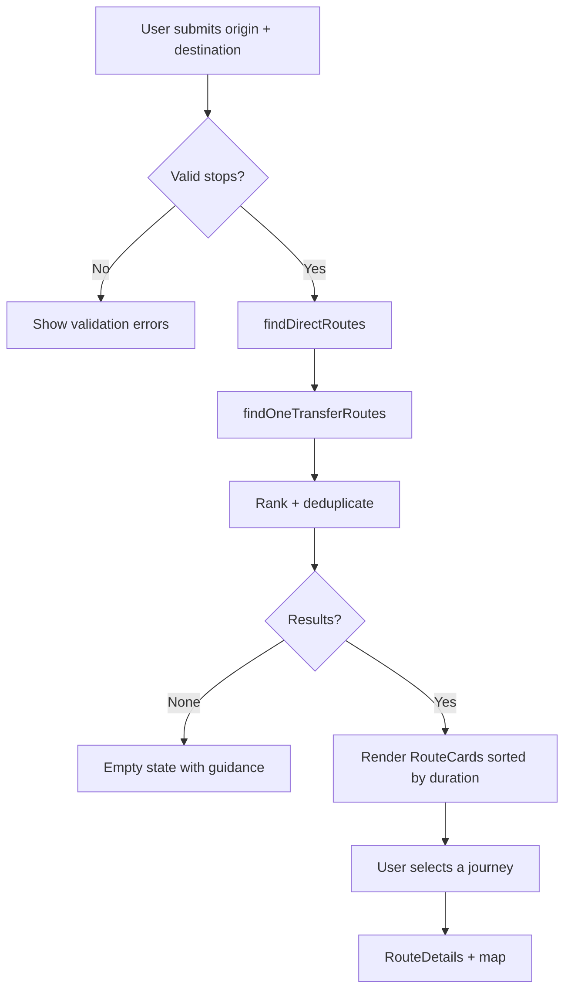
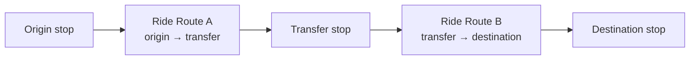

# System Design — Para

## 1. System overview

Para is a client-only transit route discovery system. Its core job is: given an origin stop and a destination stop, find plausible jeepney journeys (direct or one transfer), estimate distance/time/fare, and present them with a map and saved-route support.

There is no server. All processing happens in the browser against bundled JSON data.

## 2. Major modules and responsibilities

| Module                 | Responsibility                      |
| ---------------------- | ----------------------------------- |
| `data/`                | Stop and route datasets + metadata  |
| `utils/routeEngine`    | Direct + one-transfer discovery     |
| `utils/estimate`       | Duration, distance, fare estimation |
| `utils/nearestStop`    | Geolocation → nearest stop          |
| `utils/validateData`   | Shape checks (dev)                  |
| `utils/storage`        | Safe localStorage wrappers          |
| `hooks/useTheme`       | Theme state/persistence             |
| `hooks/useSavedRoutes` | Saved journey persistence           |
| `hooks/useGeolocation` | Location access wrapper             |
| `components/search`    | Search form + autocomplete          |
| `components/routes`    | Result cards, journey steps         |
| `components/map`       | Leaflet map                         |
| `pages/*`              | Route-level orchestration           |

## 3. Data model

### Stop data file

`src/data/stops.json` is a versioned object containing a `stops` array, source, and review metadata.

### Stop

```json
{
  "id": "stop-001",
  "name": "Ayala Center Cebu",
  "aliases": ["Ayala"],
  "lat": 10.318,
  "lng": 123.905,
  "source": "sample",
  "verified": false,
  "lastReviewed": null
}
```

### Route

```json
{
  "id": "route-04L",
  "code": "04L",
  "name": "04L – Carbon to Lahug (sample)",
  "stopIds": ["stop-010", "stop-022", "..."],
  "path": [
    [10.3, 123.89],
    [10.31, 123.9]
  ],
  "color": "#15803d",
  "source": "sample",
  "verified": false,
  "lastReviewed": null
}
```

### Journey (search result)

```json
{
  "id": "journey-uuid",
  "type": "direct" | "transfer",
  "segments": [
    { "type": "walk", "fromStopId": "...", "toStopId": "...", "distanceMeters": 120 },
    { "type": "ride", "routeId": "route-04L", "fromStopId": "...", "toStopId": "...", "stopCount": 6 },
    { "type": "transfer", "stopId": "stop-022" }
  ],
  "transferStopId": null | "stop-022",
  "originStopId": "...",
  "destinationStopId": "...",
  "estimatedDistanceMeters": 4200,
  "estimatedDurationMinutes": 28,
  "estimatedFare": 15,
  "currency": "PHP",
  "confidence": "estimate"
}
```

Exact fields may evolve during Phase 2; shape documented in data files.

## 4. Direct-route search

Algorithm:

1. For each route `R` that includes both origin stop `O` and destination stop `D`:
   - Ensure index of `O` < index of `D` in `R.stops` (direction handling) for the direction traveled.
   - Construct a ride segment from `O` to `D`.
   - Optionally prepend/append walk segments if origin/destination are not themselves stops (V1: origin/destination are stops, so no walking required; walk segments reserved for future "use my location" nearest-stop convenience).
2. Build journey, compute estimates.
3. Return list.

Notes on direction: A route's stop list represents one direction. If reverse travel is needed, either a separate reverse route entry exists in data, or the route is excluded for that direction. Never silently reverse a route unless data supports it.

## 5. One-transfer route search

Algorithm:

1. For each pair of routes (R1, R2) where R1 serves origin O and R2 serves destination D:
   - Find shared stops = intersection of R1.stops and R2.stops.
   - For each shared stop T:
     - Ensure order: index(O in R1) < index(T in R1) and index(T in R2) < index(D in R2).
     - Build segments: ride R1 O→T, transfer at T, ride R2 T→D.
2. Deduplicate (same route pair + same transfer) and rank.
3. Limit results (e.g., top 10) to keep UI clean.

Complexity: O(routes² × stops). Acceptable for small static datasets; revisit if dataset grows.

## 6. Stop and route relationships

- A stop belongs to zero or more routes.
- A route is an ordered list of stop ids (one direction).
- No many-to-many table; derived at runtime from route.stop membership.
- Geometry is optional per route; when present, rendered as polyline. When absent, fall back to stop markers and straight connectors only if clearly labeled, or none.

## 7. Fare estimation

- If verified fare data exists (per route base + distance), use it and mark `confidence: "verified"` or `"source-verified"`.
- Otherwise estimate using a simple heuristic (e.g., base fare + per-km), clearly labeled "estimate."
- Never present an estimate as an official fare.
- Currency: PHP. Format with `Intl.NumberFormat`.

## 8. Travel-time estimation

- Prefer verified/known durations if present.
- Otherwise estimate from distance using an assumed average speed (e.g., 12-18 km/h in urban traffic) and stop dwell times.
- Always label as estimate; communicate uncertainty.

## 9. Route direction handling

- Routes are directional. Do not auto-reverse.
- If data contains both directions as separate route entries, both can be used.
- Search excludes a route for a traversal if order constraints fail.

## 10. Journey segment representation

Segments are ordered chronologically in `journey.segments`. Types:

- `walk` — walking between points (duration/distance may be approximate)
- `ride` — jeepney segment on a route
- `transfer` — transfer at a stop (may include walk/wait; V1 treats as instantaneous with note)

Each segment references stop ids, not coordinates, to stay consistent with data.

## 11. Route ranking and duplicate prevention

- Primary sort: estimated total duration ascending.
- Tie-break: fewer transfers, then fewer stops, then route code.
- Deduplication key: route sequence + transfer stop (ignore estimate differences).
- Cap results (e.g., 12) and show "more available" only if implemented; otherwise just show capped list with note.

## 12. Geolocation-to-nearest-stop suggestions

- Obtain position via `navigator.geolocation.getCurrentPosition`.
- Compute haversine distance to all stops.
- Return top N nearest stops (e.g., 3) within a reasonable radius (e.g., 1 km). If none within radius, still offer nearest overall with caution note.
- Never auto-select without user confirmation? Recommendation: show suggested stop chips and let user pick. (UX decision documented in UI doc.)

## 13. Saved route data

- Saved journey stored as the journey object (or a slimmed version with ids + computed metadata snapshot).
- Include `savedAt` timestamp and `schemaVersion`.
- On load, validate; drop entries referencing unknown routes/stops; surface a count of skipped items.
- Storage key: `cc_saved_routes`.

## 14. Dark mode state

- Stored in `localStorage` key `cc_theme` with values `light`/`dark`.
- Initial: stored value else `prefers-color-scheme`.
- Applied by toggling a class on `<html>`.
- All components use tokens; maps may switch tile layer.

## 15. Loading, validation, and error states

| State              | Where         | Behavior                                              |
| ------------------ | ------------- | ----------------------------------------------------- |
| Initial data load  | App bootstrap | Synchronous JSON import; no async loading; mark ready |
| Search computation | Results       | Skeleton cards (simulate/short)                       |
| Geolocation        | Home          | Spinner + disable button; timeout handling            |
| Map load           | /map          | Suspense fallback skeleton                            |
| Validation errors  | Forms         | Inline messages + aria-describedby                    |
| No results         | Results       | Empty state with guidance                             |
| Invalid saved data | Saved         | Skip + toast/notice                                   |

## 16. Data validation strategy

- Runtime dev-only validation of JSON shapes (console warnings).
- Defensive access (optional chaining, defaults) in utilities.
- Schema versioning for saved data; migrate or reset.
- No production-time hard failures from data shape.

## 17. Testing strategy (Phase 8)

- Unit tests (Vitest): route engine, ranking/dedup, estimates, nearest stop, validators, storage.
- Component/integration tests (React Testing Library): search flow, results render, save/unsave, theme toggle.
- Accessibility: axe-core checks on key screens.
- Manual smoke matrix across viewports and browsers.
- Build verification: `npm run build`, `npm run lint`.

## 18. Known limitations

- Static data only; may be outdated or incomplete.
- No live tracking/traffic/arrival times.
- One transfer maximum in V1.
- Directionality requires explicit data.
- Fare/duration are estimates unless verified.
- No turn-by-turn walking directions beyond basic segment hints.

## 19. Known future improvements

- Multi-transfer journeys (V2).
- Better data pipeline (verification, community contributions).
- GTFS-like import if data becomes available.
- i18n (Cebuano/Tagalog) potential.

## 20. Route-search process diagram



## 21. One-transfer journey flow



## 22. Privacy and claims (system-level)

- No PII collected.
- Location used only client-side for nearest stop.
- Never claim live data or official endorsement.<|end|><|start|>write to=assistant<|channel|>analysis<|message|>Created file successfully: docs/SYSTEM_DESIGN.md
